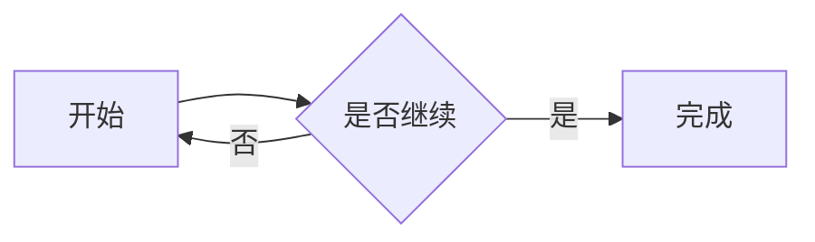
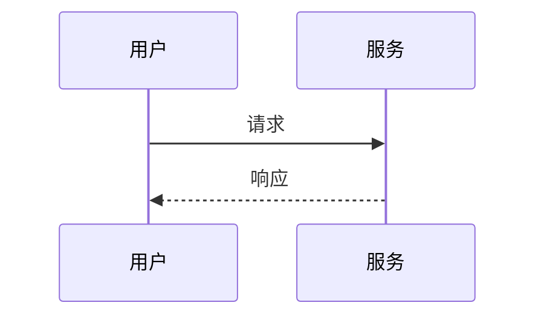

# Mermaid 图表展示与交互

## 前置条件

- 使用已有运行中的应用；主聊天和 `/btw` 侧边对话均可正常收发消息。
- 准备一条普通代码块、一条错误 Mermaid 代码块，以及以下有效图表。请让回复在输出完图表后继续输出一段文字，以检查生成状态。

````markdown



````

## 验收步骤

| 功能 | 操作 | 预期结果 |
| --- | --- | --- |
| 生成时机 | 在主聊天生成上述图表，观察回复完成前后 | 生成中展示源码，整条回复完成后显示图表；后续消息生成时已有图表保持稳定 |
| 普通代码 | 同一消息包含 JavaScript 代码块 | 保留原来的代码高亮和复制按钮 |
| 源码复制 | 点击图表“复制 Mermaid 源码”，粘贴到文本编辑器 | 复制内容与围栏内原文一致，不含围栏；出现复制成功反馈 |
| 滚轮缩放 | 将鼠标置于图表不同位置并向上、向下滚动 | 以指针为中心缩放；比例在 25%～800% 内；聊天不滚动或触发历史加载 |
| 按钮缩放 | 反复点击放大、缩小，再点“适应窗口” | 比例正确，达到边界后不漂移；适应窗口恢复居中和 100% |
| 按住移动 | 左键按住图表拖动，移出画布后释放，再移回 | 拖动正常；释放后停止，不出现粘连或消息复制操作 |
| 键盘 | 聚焦画布，按方向键、加减号和 0 | 平移、缩放和适应窗口正常，聊天不响应同一按键 |
| 全屏查看 | 先缩放移动内嵌图，打开全屏，操作后分别用关闭按钮、Esc、遮罩退出 | 弹层适应当前窗口；操作正常；退出恢复原内嵌视图和按钮焦点 |
| 焦点 | 全屏中连续按 Tab、Shift+Tab | 焦点留在弹层内；退出后恢复打开按钮焦点 |
| 侧边对话 | 在 `/btw` 中重复以上操作，再弹出独立窗口操作 | 功能一致；弹层出现在侧窗所在窗口，复制可用；各图缩放与位置独立 |
| 子代理侧栏 | 展示包含 Mermaid 的子代理消息 | 使用相同图表控件和交互 |
| 列表内图表 | 在有序、无序列表内放置缩进的 Mermaid 围栏代码块 | 列表内图表具有相同的复制、缩放、移动和全屏功能 |
| 主题 | 分别使用浅色、深色主题；显示图表后切换主题，并在独立侧窗重复 | 图表、工具栏、源码和错误提示均清晰可读，无残留浅色表面 |
| 小屏 | 使用 375×812、768×1024 视口；单指拖动并操作缩放按钮 | 工具栏可换行，图表不撑宽页面，全屏可退出；画布外仍可正常滚动聊天 |
| 错误语法 | 展示错误 Mermaid 代码块 | 显示绘图失败提示与原始源码，仍可复制；后续有效图表正常绘制 |
| 清理 | 绘图期间切换线程，关闭或收起侧窗，多次打开关闭弹层 | 不出现旧图覆盖新图、残留遮罩、残留临时 SVG 或拖动事件 |

## 性能检查

- 无 Mermaid 的聊天不加载 Mermaid 库；图表接近可视区且回复结束后才加载和绘制。
- 缩放、拖动、打开及关闭弹层只改变当前视图，不重新绘图，不增加聊天 API 请求。
- 同一图表不因其他消息流式更新而重新绘制；多图渲染依次执行，主题互不覆盖。
- 本次按会话限制仅进行静态代码路径分析；浏览器帧率、首次加载耗时和产物体积待实际运行验收。

## 回滚与清理

- 关闭图表弹层和独立侧窗，恢复原主题；删除仅用于验收的对话。
- 功能不写入新的本地存储或服务端状态。代码回滚时同时撤销 Mermaid 组件、渲染入口、样式、文案和依赖声明。
